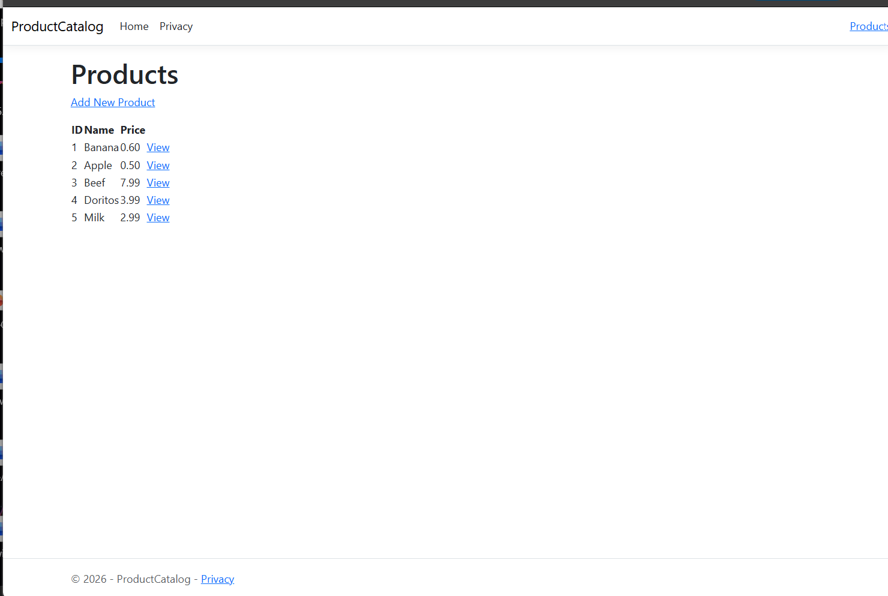
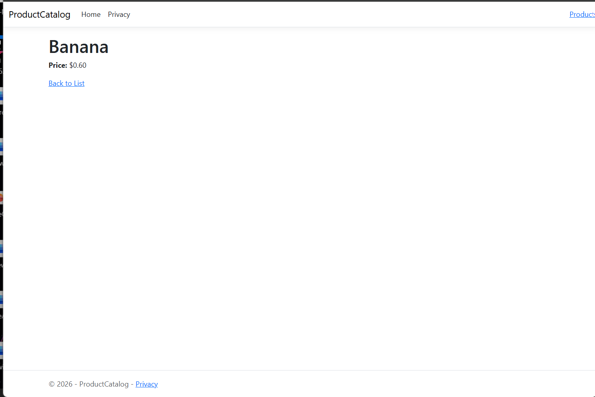
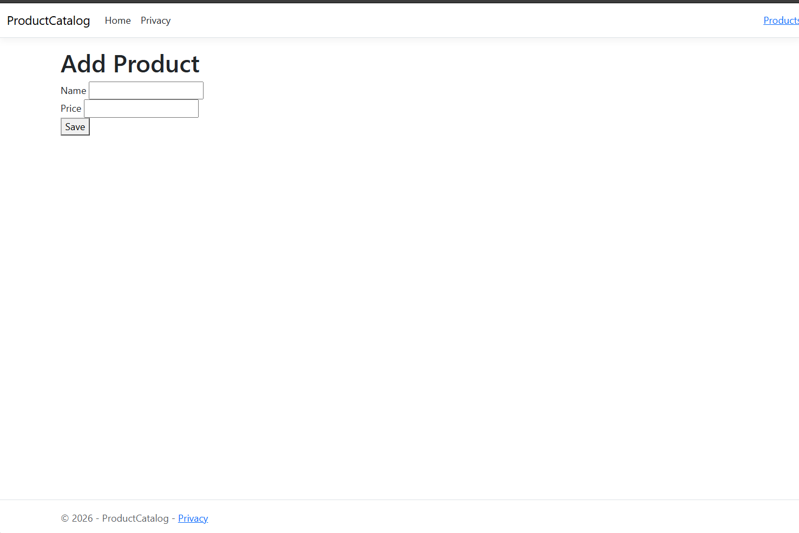

# MVCProductsCatalog

## MVC Products Catalog

This ASP.NET Core MVC project demonstrates controllers, strongly typed Razor views, model validation, and JSON file storage for managing a product catalog.

## Features

- ProductsController with Index, Details, and Create actions
- View a list of products
- View individual product details
- Add new products using a form
- Product name validation with `[Required]`
- Product price validation with `[Range]`
- Saves products to `data/products.json`

## Screenshots

### Products Page

### Product Details

### Add Product

